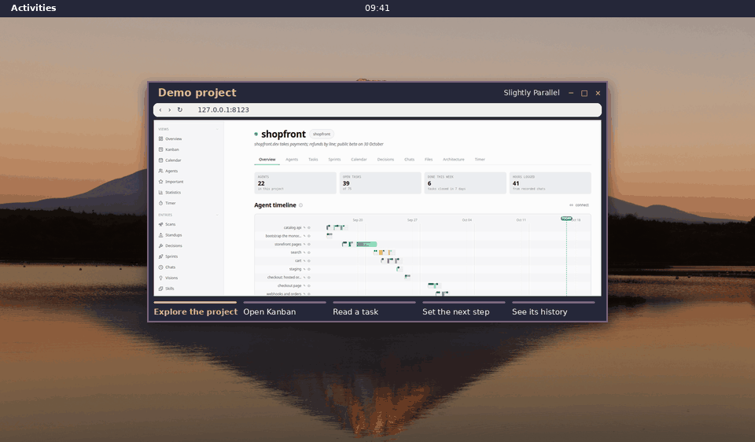
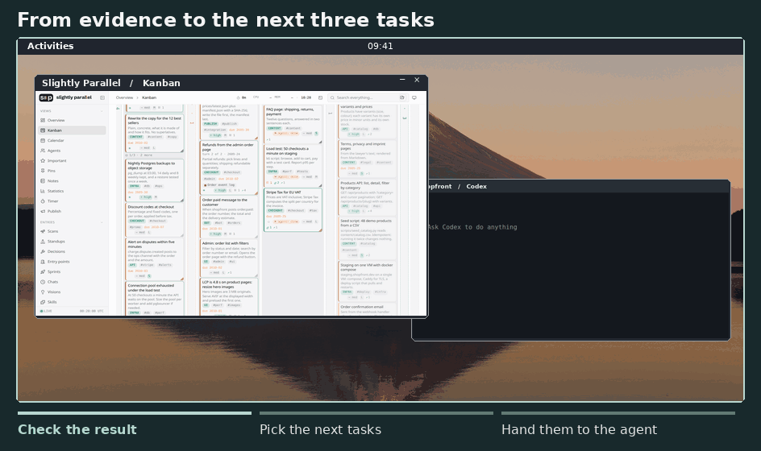
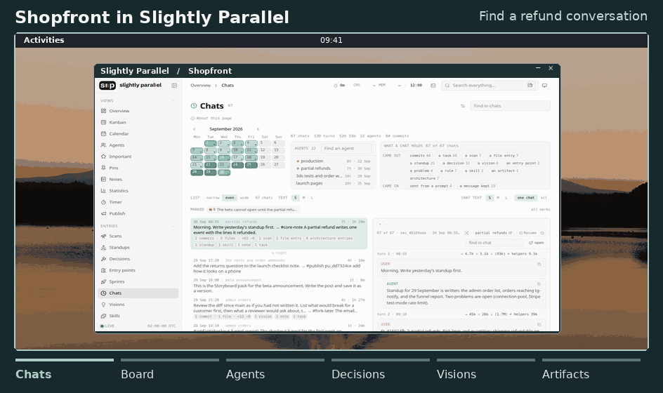
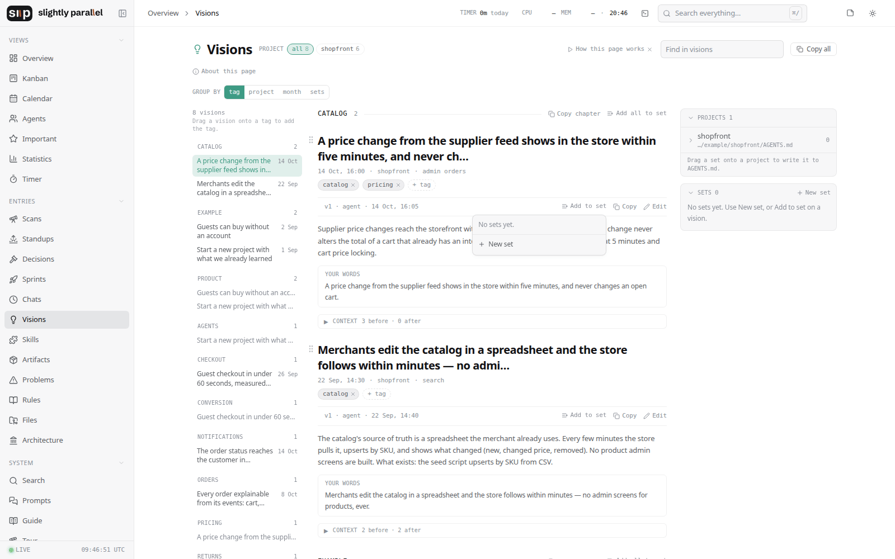
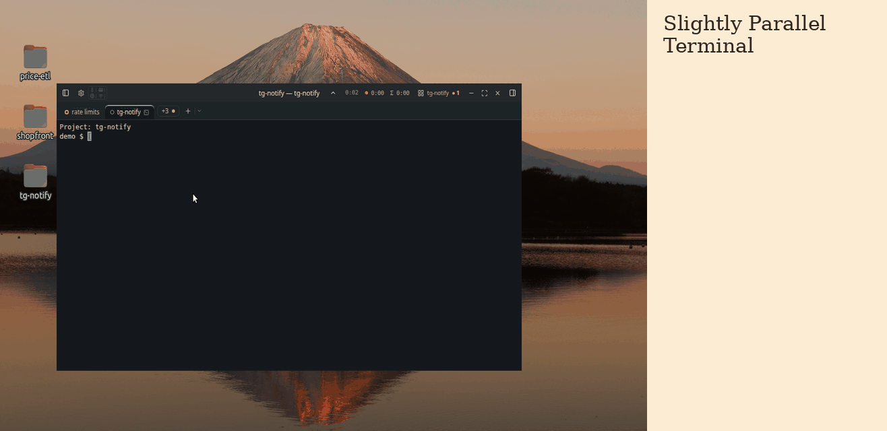
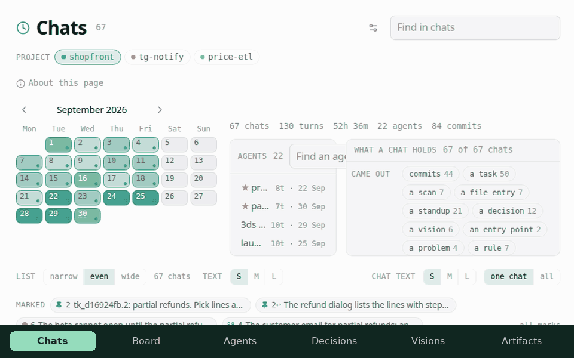

# Slightly Parallel

[](https://github.com/NMar33/slightly-parallel/actions/workflows/ci.yml) [](https://github.com/NMar33/slightly-parallel/releases) [](https://www.python.org) [](LICENSE) [](https://youtu.be/NmtQgkg-D-E)

Are you tired of switching between projects?

Slightly Parallel is an open-source dashboard that runs on your own computer and helps you to manage projects with multiple agents. You can work as usual in a terminal or in EDA, in Claude Code or Codex, but on top of that you get task management, program architecture management and the ability to resume any task from any point and never lose the context again.

## Works with

- Claude Code, Codex, OpenCode
- Linux, macOS, Windows

## Install

You can watch how to install it on YouTube: [Install it and connect your first project](https://youtu.be/iVSJEZdb7Nw) (4:08).

You need Python 3.11+ and Git.

```bash
git clone https://github.com/NMar33/slightly-parallel.git
cd slightly-parallel
./run.sh --prod       # Linux, macOS
```

On Windows, instead of `./run.sh --prod`: `sp run --prod`.

The dashboard is available locally at http://127.0.0.1:8123.

<details>
<summary>Install and open SP terminal</summary>

You can use SP in your browser and keep working in your usual terminal. If you want the SP terminal, install Node 20+ with npm and turn on the terminal in **Settings › Terminal**. From the Slightly Parallel folder, run `./sp.sh window` (Windows: `sp window`). The first launch installs Electron. Pick your project, open a terminal tab and start your agent there. You can group tabs, switch projects and see your work timer in the window.

</details>

<details>
<summary>There is a small demo project, so you can check how it works before using it in your own work</summary>

Small demo project. It goes in the folder `~/.slightly-parallel`, and when you open http://127.0.0.1:8123 you will see a project for a small online shop. It has data on all the pages in Slightly Parallel, so it should be easier to understand how to use SP and what benefits it gives you. When you no longer need it, click **Hide** above the example project in the sidebar.

</details>



### How do you connect your own project?

Go to **Setup** → **Data folder** → **Integrate a project**.

That's it.

<details>
<summary>Connecting a project in more detail</summary>

Go to the **Setup** page:

1. Choose the **Data folder**. This is where SP keeps its records. (The default should be fine.)
2. Next step: **Integrate a project**.
   1. Choose a project folder (it can be a new one or an existing one). SP doesn't write files in this folder (except for the `AGENTS.md` and `CLAUDE.md` entries, MCP configuration and hooks it needs to integrate with the agents), but it tracks Git activity and which agents start in this folder. (It stores its own data, including chats and tasks, in the data folder.)
   2. Give the project a name.
   3. Check which files will be written to the project folder and which agents you want to integrate. So if you work only with Claude Code, just integrate it, but if you think you might try Codex a month later, just integrate them all.


</details>


## What Slightly Parallel can do for you


You can work on the project as usual, in the tools you like. Once you integrate a project, SP uses hooks to record the chats and store them in the folder you chose.

Using special commands (`#rule`, `#vision`, `#important`), you can save messages along with their context. With task commands, you can manage tasks right from your Claude Code chat (or from the SP GUI if you want).



SP also has automatic events. For example, the daily standup helps you keep a development diary and follow changes to the architecture. Besides that, SP has its own terminal (you need Node 20+ to install it). Working with it takes things to a whole new level.




There are a few levels of SP adoption.

### Level 1. Install and forget

You install SP, integrate some project (for example, `THE_SAAS_THAT_MAKES_ME_RICH`) and completely forget about SP.

Even in this sad scenario, you still get the benefits. A month later, after hundreds of chats with, for example, Claude Code, you can find that exact chat you need because SP keeps all your chats and agents organised. (And it’s even simpler if you add some tags, for example, `#important`.)

### Level 2. You use SP

In this case, you run the SP server locally on your computer. Here are the things that make your work experience much better.

1. The Kanban board. It has a nice GUI, but most importantly, it’s heavily integrated with agentic development. So you don’t have to switch between your beloved terminal and the GUI. You can work in the terminal as usual and just use special tags to control tasks.

<details>
<summary>Some of the task commands</summary>

- `#task` gives the agent a nudge to write up the task itself.
- `#now` creates a task on your behalf (the agent just adds context). The task goes into Doing.
- `#now-todo` is the bomb. You’re working, you see a bug or get an idea. Just write it down, stick the tag on it, and it goes straight into To do without taking you away from your current work (again, the agent just adds context).
- One small thing: if you don’t give a task a name, that’s OK. The agent will write one based on the task context.

There are more commands. More on those [below](#the-commands).

</details>

2. You can easily collect and manage the relevant experience you gain on the project.

   2.1. You can create (and collect) prompts, artifacts, skills, problems, rules, decisions and much more. It sounds like a lot, but in reality it’s really simple. SP doesn’t require any special discipline. You just work as usual until there’s a moment. A moment when you think, hmm… that’s worth saving or remembering. Or, WTF, that shouldn’t happen again.
   So when that moment comes, SP probably has a command for it. So you just type it in your usual tool (Claude Code, Codex, etc.), and that’s it.

   <details>
   <summary>Commands for the things you want to keep</summary>

   - `#prompt` saves a prompt you want to use again.
   - `#artifact` keeps something an agent made, like a dataset or a small app.
   - `#skill` asks the agent to write down how it did the work so another agent can follow the same steps.
   - `#problem` records a problem. `#problem solved` marks it as solved.
   - `#rule` saves a rule for agents working on your project.
   - `#decision` records what you chose and why.

   </details>

   2.2. SP has an easy-to-use GUI for managing these things. You can group important rules into sets, add them to new projects with one click, keep earlier versions, and so on. I’ve used rules as the example here, but of course there are lots of things you can do with the other entries too.

   <details>
   <summary>Here’s a GIF showing how sets work</summary>

   

   </details>

3. SP helps you manage the architecture of your project with commands like `#core` and `#entrypoint` and with regular architecture reviews.

   <details>
   <summary>How it works and the philosophy behind it</summary>

   When you work on your project and see something “inside” that’s really important, you can use `#core-new` to start tracking it. Say it’s the terminal. Later, when you’re working on it again, type `#core` to link the message and your current task to it. In **Architecture › Cores**, you can see the files, tasks and notes for the terminal together.

   An entry point is a topic you want to come back to. Say you’re working on the demo. Type `#entrypoint` and name the topic. The agent records where the files are, how to run the demo and where you stopped. Next time, even in a different chat, you can use the same topic name.

   For a regular review, type `#scan` when you finish a stage of work. It records what changed. Use `#architecture` to bring the architecture page and program map up to date.

   </details>


### Level 3. You use SP with the SP terminal

It’s a complete game changer. The same things you have in SP, but built into the terminal. Switch between projects and workspaces, create groups, check how long you’ve been working and take care of your health.



### More info

<details>
<summary>How to start the server again and where everything is</summary>

- **To start the server again:** `./run.sh --prod` (Windows: `sp run --prod`). To keep it running in the background: [docs/running.md](docs/running.md).
- If you don't start the server, chats will still be recorded because the hooks do that, but all other functions will be unavailable.
- **Where everything is:** SP writes its data to the folder you chose in step one of Setup. In this folder, open `projects`, then the folder with your project's name. That's it. Inside you'll find the chats in `chat.md` files, and the tasks and the rest as CSV plus one Markdown file per entry.

</details>

<details>
<summary>More about OpenCode</summary>

The first time OpenCode starts in a project, it downloads a package for its plugins. This can take several minutes, and OpenCode shows nothing while it runs.

</details>

<details>
<summary>Chat commands</summary>

If you want to know more about commands and SP, just type `#help` in the chat with your agent and it will give you the full list, or you can see [The commands](#the-commands) below.

</details>

<details>
<summary>Dev info</summary>

Working on Slightly Parallel's own code needs Node 20+: [docs/development.md](docs/development.md).

</details>


You can work on the project as usual. SP keeps every chat, puts the work on a board, and makes the agents write down what matters: what changed, what was decided, what the project is for. The aim is a step from vibe coding to leading a team of agents: you know the code, the architecture and the decisions, even when an agent wrote most of it.




<a id="the-commands"></a>

<details>
<summary>Chat commands and dashboard pages</summary>

- **Chats and Pins.** Search recorded conversations. Use `#important` to mark a message, `#pin` to return to it, or `#fork-later` to save the command for starting a separate chat from it.
- **Kanban.** Use `#task` for later work, `#now` to start a task, `#evidence` to attach proof and `#done` to close the task. Open its card to read the discussion.
- **Standups, Scans and Architecture.** Read yesterday’s work in Standups or request the report with `#standup`. Use `#scan` for a checkpoint, `#page` for the architecture overview and `#map` for the connections between parts of the program.
- **Rules, Visions, Problems and Decisions.** Save each with `#rule`, `#vision`, `#problem` or `#decision`. Open its page to read the entry and the conversation behind it.
- **Prompts, Skills and Artifacts.** Use `#prompt` for text you want to reuse, `#skill` for a procedure and `#artifact` for files you want to keep.
- **Notes and Publish.** Review a plan, checklist or report in Notes. Use `#publish` to collect shipped work for a document.
- **Timer, Usage and Monitor.** Timer shows your work hours. Usage shows agent tokens and plan limits. Monitor shows the state of the computer, server and terminal.
- Type `#help` in a chat for the full command list.

</details>

## What it needs and where the data is

- One person, one computer. The server listens on `127.0.0.1` and has no login; the network is off unless you turn it on ([docs/configuration.md](docs/configuration.md)).
- The data is plain files in the folder you chose: one CSV per kind of entry, one Markdown file per entry, the chats as `chat.md`. No database server. Back it up by copying the folder, or let the Backups page do it.
- Agents write only through the MCP server. For example, they use `write_entry` to record a decision. The contract they follow is [`SLIGHTLY-PARALLEL.md`](SLIGHTLY-PARALLEL.md).
- The pages: Overview, Project, Chats, Scans, Standups, Decisions, Kanban, Sprints, Calendar, Timer, Visions, Rules, Problems, Skills, Prompts, Artifacts, Entry points, Important, Architecture, Files, Search, Agents, Timelapse, Monitor, Backups, Settings. English and Russian.

## More

- [docs/integration.md](docs/integration.md) — what Setup writes into a project, the contract, the commands, the built-in skills, the same call without a browser.
- [docs/configuration.md](docs/configuration.md) — `.env`, the ports, the network and the terminal; what the security model is and is not.
- [docs/running.md](docs/running.md) — the launcher: `sp.sh up`, `status`, `logs`, `restart`, `down`; Windows.
- [docs/development.md](docs/development.md) — the hot-reload start, tests, the lock file, the fresh-user test.
- [docs/api.md](docs/api.md), [docs/logging.md](docs/logging.md) — the HTTP API and MCP tools; how chats are recorded.
- [docs/performance.md](docs/performance.md) — what the server uses (memory, time), how it was measured, what was changed.
- [docs/release-testing.md](docs/release-testing.md) — what is checked before a release, the checks done by hand on Windows and macOS, and the ones still to build.
- [docs/help.md](docs/help.md) — how to: import lost chats.
- [AGENT-README.md](AGENT-README.md) — for an agent working on Slightly Parallel's own code.

## License

MIT — see [LICENSE](LICENSE).
