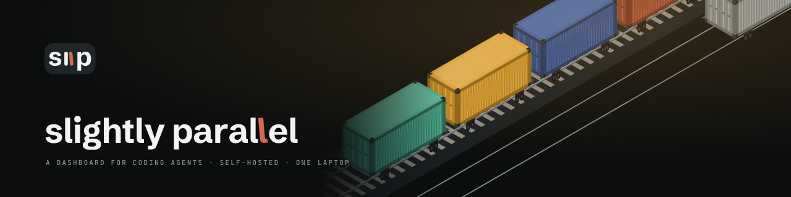

# Slightly Parallel

**A dashboard for coding agents. Open source, MIT; runs on your own computer.**

You work with coding agents in several repositories, maybe in several tools at once: Claude Code in one, Codex or Cursor in another. Each chat ends and its content is gone; nothing connects one project to the next.

Slightly Parallel records every one of those chats into one record and shows all your projects on one page. You write rules for the agents, visions of where a project is going, and skills, which are procedures an agent follows; what you wrote in one project can be installed into any other, so a new chat there starts with the same knowledge. For managing a project there is a Kanban board, with sprints, milestones, a calendar and your own hours; a task on the board can be handed to an agent, and its report comes back to the card.

▶ [Slightly Parallel in a minute](https://youtu.be/NmtQgkg-D-E) (0:58) · [How Slightly Parallel works](https://youtu.be/eZ0_f1sKaLE), every page in 6:42

*Both films are shot on the example project a new install starts with. In the app: the sidebar's Take the tour, or the Tour page.*

> **Working on Slightly Parallel's own code, or setting it up with an agent?** Read
> [`AGENT-README.md`](AGENT-README.md): the layout, how a write flows, the contract parts,
> the skills and the rules.

---

## What it is

Slightly Parallel is for one operator on one machine. Hooks record the chats. Agents write entries, such as scans and decisions, through its MCP tools. The operator reads the pages.

The pages, by what they show:

- **Overview** — what changed since your last visit, what waits for your decision, and the numbers of each project.
- **Project** — one page per project with tabs: overview, agents, tasks (the Kanban page: a board), sprints, calendar, terminals, decisions, chats, files, architecture, timer.
- **Agents** — each recorded chat is an agent. Its page shows its chats, files, decisions, the tasks it mentioned, and links to other agents.
- **Kanban** — the task board of each project. A task has a history. An agent reports a task done and attaches evidence. The operator keeps the status.
- **Scans, Standups, Decisions** — a scan is a checkpoint the operator asks for with `#scan`: what this chat changed since its last scan, committed or not. A standup is one per project per day, written the next day after the first agent of that day asks: a story of the day, then what went wrong, what moved, decisions, the tasks and agents of the day, and what may be forgotten. The F key shows one standup full screen. A decision carries a weight: minor, normal or major. Each of the three pages has a text-size switch.
- **Visions, Rules, Problems, Skills, Artifacts** — the server keeps a chat message tagged `#vision`, `#rule`, `#problem`, `#skill` or `#artifact`. The agent writes its interpretation, the skill's files, or the artifact's folder.
- **Architecture** — what the project is, as claims with their evidence; the top band is computed from the folder. The changes view shows what each scan changed.
- **Chats, Files, Prompts, Calendar, Sprints** — every chat with an agent, the files that changed, the operator's own prompts, dates, sprints.
- **Guide, Tour, Internals, Health, Setup, Settings, Backups** — what each page is for, walkthroughs of the pages, how chats are recorded, the server's state and log, installation, settings, copies of the data.
- **Language and appearance** — the interface is in English or Russian (Settings › Language, or Settings › Appearance); on the first start the language follows the browser's language. Appearance also sets the theme, the accent, the scale and the skin; Terminal phosphor and Dark blue are always dark, Broadsheet and Rams always light.
- **Statistics and analytics** — every finished task with what it took (messages, active time, commits, created → done); on a project's Overview tab, a task table with a query line and an analytics pipeline over messages, chats, tasks and their history, on a read-only copy.
- **Important** — `#important` stars the message, its agent and the task it names; the stars show on the board, the agents and the chats.
- **Terminal** — a shell inside the app, switched on in Settings: the ` key opens it on any page, Resume reopens an agent's chat in it, a task can start one, and each terminal shows whether its agent is working or waiting. With tmux, terminals stay open after a reload or a restart.
- **Monitor** — CPU, memory, disk, network and the connection, sampled in the background; unusual readings are kept as events. A small version sits in the top bar.

## How it works

Files are the record. There is no database server.

1. The operator talks to an agent in a project folder. A hook (`scripts/hooks/capture.py`) appends each message to `chat.md` in the data folder and returns `[slightly-parallel]` notices to the agent.
2. The agent follows the contract [`SLIGHTLY-PARALLEL.md`](SLIGHTLY-PARALLEL.md) and the built-in skills (`templates/skills/`).
3. The agent writes through the MCP server `slightly-parallel` (`backend/backend/mcp.py`), by field name: `write_entry {lens, fields}`. The translator stamps project, agent id, date and time.
4. The backend (FastAPI) appends one CSV row and one Markdown detail file. It refuses a write that names an agent and did not come through MCP.
5. DuckDB tables built from the CSV files feed the HTTP API. The pages (React, Vite, Tailwind) poll it.

## Quick start

You need **Python 3.11+**, **Node 20+** and **git**. On Debian or Ubuntu
also `sudo apt install python3-venv`. `tmux` is optional: with it, the
terminals stay open after a reload or a restart.

Five steps from clone to recorded chats. The first is in a terminal; the
rest are on the **Setup** page in the browser:

```bash
git clone https://github.com/nmar33/slightly-parallel.git slightly-parallel
cd slightly-parallel
./run.sh --prod       # builds the UI, then serves everything from http://127.0.0.1:8123
```

The first start takes a minute or two: it makes the backend's environment,
installs the UI's packages and builds the UI. To work on Slightly Parallel's own
code, `./run.sh` with no flag starts the backend on :8123 and a hot-reload UI
on :5173. On Windows: `sp run --prod` and `sp run`.

When a start fails (a port in use, Node not found), the last line says what to do.

1. **Run it** (above). The first start makes the data folder
   `~/.slightly-parallel` and plays the **example project** into it in about a
   minute: shopfront, a month of work on a small online store with the dates
   ending yesterday. Its chats show the commands the operator typed, and its
   scans, standups and decisions say which message they came from. Hide it
   from the sidebar; Settings › Example project brings it back.
2. **Pick a data folder** (optional) — Setup › Data folder: select another folder.
   It applies at once and is saved to `.env`.
3. **Integrate a project** — Setup › Integrate a project: the project code and the folder
   where its code is. Slightly Parallel writes a section into that project's
   `AGENTS.md` (and a line into `CLAUDE.md`), the capture hooks and the MCP
   server entry (`.mcp.json`). It shows the files before writing them, and
   marks a project whose section is out of date.
4. **Start an agent** in that project folder: Claude Code, Codex, OpenCode
   or Cursor. The agent reads the contract from the section, the hooks record
   its chat word for word (Cursor through its own hooks in
   `.cursor/hooks.json`), and it writes scans, standups and decisions
   through the MCP tools. Other tools that read `AGENTS.md` follow the
   contract without a recorded chat until an adapter exists
   (docs/logging.md). Every path in the section is absolute.
5. **Read the pages.** They update as the chat goes on.

### The data layout (for the curious)

Everything Slightly Parallel records is in the data folder you chose: CSV files
and Markdown detail documents. Every file is optional; a missing one shows as an
empty list.

```
~/.slightly-parallel/
├── scans.csv                     # one row per scan (append-only)
├── snapshots/*.md                # the text of each scan
├── decisions.csv  tasks.csv  standups.csv  sprints.csv  ...
│                                 # one CSV per kind of entry (see docs/api.md)
├── <entity>_details/*.md         # detail documents referenced by md_ref
└── projects/
    └── <project-code>/
        ├── chats/<agent-id>/
        │   ├── meta.json         # agent identity + headline
        │   └── chat.md           # the chat, word for word
        ├── artifacts/<name>/     # folders an agent wrote for #artifact
        ├── architecture/vNNN.md  # the architecture page, one file per version
        ├── map/vNNN.json         # the map of the program, one file per version
        └── log.md                # the project's own notes
```

## Running it as a service

One launcher, `sp.py`, on Linux, macOS and Windows (Python 3.11+ and
Node 20+). `sp.sh` (Linux, macOS) and `sp.cmd` (Windows) run it;
`run.sh` is `sp.sh run`. In the background, a server that crashes is
restarted:

```bash
./sp.sh up            # prod mode, auto-restarting, in the background
./sp.sh up --dev      # same, with the hot-reload dev pair
./sp.sh status        # supervisor / health / terminal state
./sp.sh logs          # follow the server log
./sp.sh restart       # down, then up in the same mode
./sp.sh down          # stop everything
./sp.sh run [--prod]  # in the foreground; Ctrl+C stops it
./sp.sh terminal on   # switch the embedded terminal on (the same switch as Settings › Terminal)
./sp.sh terminal off
```

On Windows the same commands are `sp up`, `sp status`, … in the
repository folder (Command Prompt or PowerShell).

## Configuration

The data folder is set in the app (Setup or Settings). Everything else is in
`.env` (see [`.env.example`](.env.example)): the address the server listens on,
CORS and the terminal are security settings, and a web page cannot change them.

| Variable | Default | Purpose |
|---|---|---|
| `SP_DATA_ROOT` | `~/.slightly-parallel` | The data folder. Set it in the app; it is saved here. Made on the first start, with the example project in it. `SCAN_DATA_ROOT` and `DATA_ROOT` are also read |
| `HOST` / `SP_PORT` | `127.0.0.1` / `8123` | The address and port the backend listens on; `SCAN_PORT` and `PORT` are also read |
| `VITE_PORT` | `5173` | The hot-reload UI's port (`./run.sh` with no flag) |
| `SP_ALLOW_LAN` | off | Needed to start with a `HOST` other than `127.0.0.1`; see below |
| `SP_CORS_ORIGINS` | localhost dev origins | The addresses the pages are opened at; `SCAN_CORS_ORIGINS` is also read |
| `SP_ENABLE_TERMINAL` | off | Forces the terminal on (it is otherwise a switch in Settings) |
| `SP_TOKEN` | made at start | Sets the terminal's token |

> **Security note:** Slightly Parallel has no login. It is built to be reached from the computer it runs on.
>
> - **Other web pages.** The server answers only requests addressed to this computer (`127.0.0.1`, `localhost`, or an address listed in `SP_CORS_ORIGINS`), and refuses a write made by another site's page. A page open in your browser cannot read your chats or change settings through it.
> - **The network.** With `HOST=0.0.0.0` every machine on the network could read every chat and change every setting, so the server starts that way only with `SP_ALLOW_LAN=1`. If you set it, also list the address you open (`http://192.168.1.5:8123`) in `SP_CORS_ORIGINS`.
> - **The terminal** runs a real shell on the host. It is off until switched on in Settings › Terminal. The server makes the token and hands it only to Slightly Parallel's own pages; every connection carries it, and requests from other sites are refused.
> - **Writes as the operator.** The server gives its own pages a cookie the first time they load (`HttpOnly`, `SameSite=Strict`). A write that names no agent and comes without the cookie is refused. A plain request from a script or an agent, such as `curl`, cannot write as the operator.
> - **Agents.** "Agents write through MCP only" and "only the operator moves a task to done" are rules for agents that follow instructions. They are not a defence against a hostile program on the same computer: it can load the page to get the cookie, or edit the data files directly. Run agents you would trust with your files.
> - **Artifacts** are files an agent wrote. Slightly Parallel shows them in a sandbox, where a script in one cannot reach the dashboard.

## Integrating a project

Open **Setup** in the sidebar, enter the project code and the project's
folder, and click Integrate. Slightly Parallel shows the files, writes them,
and lists every integrated project with its state.

There is one agent contract, [`SLIGHTLY-PARALLEL.md`](SLIGHTLY-PARALLEL.md)
in this folder. Projects point at it rather than copy it, so `git pull` here
updates the contract for every project. Setup writes a fenced
`<!-- slightly-parallel:begin … end -->` section into the project's `AGENTS.md` (the
cross-tool agent instructions standard, read natively by Codex, OpenCode,
Cursor, Gemini CLI, and others), the `@AGENTS.md` bridge line into
`CLAUDE.md` for Claude Code, the capture hooks into
`.claude/settings.local.json`, and the MCP server entry into `.mcp.json`
(with the Cursor hooks, also into `.cursor/mcp.json`, the file Cursor reads).
The same call without a browser:

```bash
curl -s -X POST http://127.0.0.1:8123/api/setup/integrate \
  -H 'Content-Type: application/json' \
  -d '{"project_code":"my-app","project_dir":"/abs/path/to/my-app"}'
```

Start the agent **in that folder**: hooks are set per folder. The first
turn prints `[slightly-parallel] project my-app · your agent_id is … · now …`; that
line shows the chat is being recorded. Git is optional in a project: with it,
scans list the commits and count the lines.

Every new chat in that folder, in any tool, reads the contract
from the section. The contract covers the commands (`#scan`, `#architecture`,
`#map`, `#task`, `#decision`, `#standup`, `#evidence`, `#done`, `#help` and the kept tags),
when to write which entry, and what each entry holds. Procedures live in
built-in skills: `make-a-scan`, `keep-the-architecture-page`,
`map-the-program`, `update-the-architecture`, `daily-standup`,
`log-a-decision`, `write-a-task`, `task-evidence`, `make-an-artifact`,
`finish-a-task`, `sp-help`.
Slightly Parallel installs them once, for all projects, into `~/.claude/skills` and `~/.agents/skills`, once, for all projects.

Details: [`docs/logging.md`](docs/logging.md) for how chats are recorded,
[`docs/api.md`](docs/api.md) for the HTTP API and the MCP tools, interactive
API docs at `http://127.0.0.1:8123/docs`, and the in-app **Guide** page for
what each page is and what an entry holds.

## Development

Each block starts in the repository folder.

```bash
# Backend
cd backend && python3 -m venv .venv && .venv/bin/pip install -r requirements-dev.txt
.venv/bin/python -m pytest
```

`backend/requirements.txt` holds the ranges, `backend/requirements.lock` the
exact versions the tests ran on; `sp.py` installs from the lock, once,
and again when the file changes. To refresh the lock — after a change to
`requirements.txt`, or to take newer releases — resolve it in a fresh
environment, run the tests on exactly that, and keep the result:

```bash
# Backend — refresh requirements.lock
cd backend && python3 -m venv /tmp/sp-lock
/tmp/sp-lock/bin/pip install -r requirements.txt
{ grep '^#' requirements.lock
  /tmp/sp-lock/bin/pip freeze --exclude pip --exclude setuptools --exclude wheel \
    | sed 's/^\(uvloop==.*\)$/\1 ; sys_platform != "win32"/'; } > requirements.lock.new
mv requirements.lock.new requirements.lock
/tmp/sp-lock/bin/pip install pytest httpx pyflakes pytest-xdist
/tmp/sp-lock/bin/python -m pytest
```

`pyproject.toml` lists the same ranges as `requirements.txt`: change both.

```bash
# Frontend — unit tests, typecheck, build
cd frontend && npm install
npm test && npm run typecheck && npm run build

# In the browser, on a copy of the test data. It starts its own server from
# backend/.venv and serves the build above. Once: npx playwright install chromium
npm run e2e
```

```bash
# From `git clone` to a working setup, as a new user meets it; with an
# agent login it also talks to a real agent (scripts/fresh_user/README.md)
python3 scripts/fresh_user/run.py --no-agent
```

## License

MIT — see [LICENSE](LICENSE).
