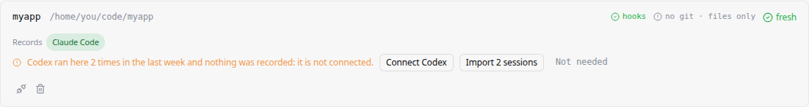
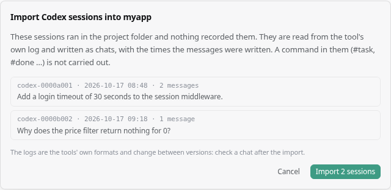

# Slightly Parallel Help

- [Import lost chats](#import-lost-chats)
- [Known limitations](#known-limitations)
  - [Import from OpenCode](#import-from-opencode)

## Import lost chats

If a tool works in a project that does not record its chats, the chats are lost. You can import them from the tool's own log.

A chat is lost when:

- the tool is not connected to the project;
- the tool did not run its hooks (Codex skips them until you trust them).

**To import lost chats**

1. Open **Setup**.
2. Under **Integrated projects**, find the project.
3. Click **Import N sessions**.
4. Check the list, and then click **Import N sessions** again.

**Notes**

- You can import Claude Code and Codex sessions from the last 7 days.
- Commands in imported messages, such as `#task` or `#done`, are not run.
- A session that was active in the last hour is not imported.
- The tools change their log format between versions. After an import, check the chat.

## Known limitations

### Import from OpenCode

You cannot [import lost chats](#import-lost-chats) from OpenCode. OpenCode keeps its chats in a database, which Slightly Parallel does not read yet.
