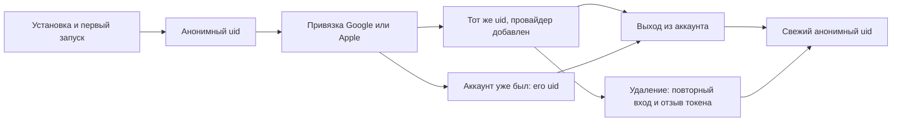

# Tidepool: аккаунты, вход и удаление аккаунта

Записка собрана 2026-11-16 только чтением: код в `2512-tidepool-app/app` (ветка main), бэклог, чек-лист телефона, отчёты агентов в `design-rounds`, навигатор `agents/tidepool-nav.md`, лента выбора экранов `agents/picker`, задачи, решения и точки входа в Slightly Parallel, записанные чаты проекта. Ничего не менялось.

## 1. Что есть сейчас

Отдельного экрана регистрации в Tidepool нет. При первом запуске приложение тихо создаёт анонимного пользователя Firebase (свой uid), и дневник работает полностью без входа: записи, метки настроения, напоминания, экспорт. В Settings есть блок Account, где можно привязать Google или Apple к тому же uid. Если этот аккаунт Google или Apple уже входил в Tidepool раньше, приложение переключается на его uid и показывает «Welcome back to your Tidepool account». Записи дневника при любом исходе хранятся только на телефоне, в локальной базе SQLite: на сервер не отправляется ни одна запись.

Провайдеры на сегодня такие. Анонимный режим работает на Android и iOS. Google работает на Android и iOS. Apple есть только на iOS: на Android кнопку Apple решили не показывать ещё в июньском разборе экранов входа. Вход по почте, magic link и по номеру телефона не делались намеренно: в разборе `design-rounds/2606-sign-in/topics/04-choices.md` записано, что ссылка из письма тянет за собой app links, отправку почты, письма в спаме и около двух недель работы, а пользоваться этим будет малая доля людей.

Как это устроено в коде. Подключены только `firebase_core` и `firebase_auth`, отдельного пакета для Google нет. Google и Apple проходят через `signInWithProvider` и `linkWithProvider`, поэтому на Android вход Google открывает вкладку браузера со страницей Firebase, а не системное окно выбора аккаунта. Код в `lib/account/account_service.dart` (два слоя: `AccountService` ведёт порядок шагов и превращает ошибки в понятные исходы, `FirebaseAccountGateway` только зовёт Firebase), экран в `lib/settings/account_card.dart` и `lib/settings/provider_buttons.dart`. С 2026-11-05 (коммит 1c7e3a9) карточка аккаунта берёт состояние входа из подменяемого провайдера, и тесты со снимками на Linux рисуют её без входа, с Google и с Apple. Обычная сборка для Linux и Windows вместо карточки показывает строку «Sign-in lives in the phone app».

Экраны аккаунта Марта выбрала в ленте выбора 2026-11-14: вход по варианту b2 (две кнопки одной ширины на карточке, на iOS Apple первой и чёрной в светлой теме, выход отдельной строкой ниже), удаление по варианту e1 (строка Delete account в разделе Privacy прямо под Erase journal, простой диалог «Delete your Tidepool account?» и снекбар после).

Выход (Sign out) сделан 2026-11-14 (5e9b2d0). После выхода приложение заводит новый анонимный uid, записи на телефоне остаются на месте.

Удаление аккаунта сделано 2026-11-14 (5e9b2d0). Шаги такие: повторный вход тем же провайдером, для Apple отзыв токена (`revokeTokenWithAuthorizationCode`, этого требует Apple), удаление пользователя в Firebase, новый анонимный uid. Записи на телефоне не стираются, это решение Марты («дневник остаётся у человека», записано в `design-rounds/2611-02-brief-check/answers/a0-brief-vs-code.md`). Анонимный пользователь тоже может удалить аккаунт, и тогда окно входа не появляется. Отдельно есть Erase journal: оно стирает записи на телефоне и аккаунт не трогает.

Правки после аудита входа сделаны 2026-11-14 (a83f61c). При любой неудаче входа, выхода или удаления снекбар показывает код ошибки Firebase с подписью «support code». Если адрес почты уже занят аккаунтом с другим способом входа (сначала Google на Android, потом Apple на iPhone), приложение сразу предлагает войти вторым способом, а на Android, где Apple нет, прямо об этом говорит. Сборка в Codemagic останавливается на iOS, если `GoogleService-Info.plist` пустой или битый. В тот же день (d07c4e8) из карточки входа убрана фраза «Keep your streak safe in the cloud»: Марта сказала, что облака у дневника нет и обещать его нельзя.

На диске лежит незакоммиченная работа (git status на 2026-11-16): правки в `account_service.dart`, `account_card.dart`, тестах аккаунта и `codemagic.yaml`. По смыслу это доработка после круга критиков (`design-rounds/2611-05-app-dev/answers/a6-critics.md`): если человек закрыл второе окно входа, приложение говорит, каким способом входить, и сообщение собирается по фактическому исходу; проверка plist в Codemagic ловит пустые значения. Кто и когда это закоммитит, не записано.

Синхронизации записей больше нет. Её сделали в июле (2026-07-15, первая фаза: анонимный вход плюс Google, записи шифровались и уходили пачками в Firestore), потом выключили и 2026-11-14 удалили из кода (7b20f19, хвосты 0e4ad83) по решению Марты, что первая версия выходит без облака. Как вернуть, описано в `debts/2026-07-28-journal-sync.md`. В локальной базе остались две колонки настроек синхронизации, чтобы не писать миграцию. `firestore.rules` в репозитории остался: вошедший пользователь читает и пишет только `/journals/{свой uid}`, приложение туда ничего не пишет. Выложены ли правила в Firebase, не подтверждено.

Сайт. Страница `tidepool.example/delete-account` сделана 2026-11-14 (c41e8a2): два пути, как требует Play (удалить аккаунт или стереть данные и оставить аккаунт), шаги в приложении и путь через письмо для тех, кто уже удалил приложение, с ответом в течение 30 дней. Позже ссылку на неё убрали из подвала сайта и оставили только в privacy (f62d0b3). Privacy переписана без синхронизации и шифрования, с Sign in with Apple и именем, которое передают Google и Apple. Сайт выложен по слову Марты, `/delete-account` на проде отвечает 200 (чат cc-8e2f41a7, 2026-11-14). В перепроверке `a5-recheck.md` остались замечания к privacy: нет срока хранения, IP и данных устройства, которые обрабатывает Firebase, имени разработчика, фразы про детей младше 13; фраза «Afterwards we hold nothing about you» на странице удаления неверна. Поправлено ли это после перепроверки, неизвестно.

Чего нет или что не проверено.
- Ни вход, ни выход, ни удаление ни разу не проверены на настоящем телефоне. В журнале разработки и отчётах нет ни одной строки «вход прошёл на устройстве» (`a4-sign-in-audit.md`). Тесты (по последним отчётам 281 и 290 юнит-тестов, e2e 64 на Linux) идут против подменённого Firebase.
- Codemagic ни разу не собирал версию с Apple и удалением аккаунта: в репозитории `tidepool-release` старый коммит, `origin/main` рабочего репозитория стоит на 2a91c5e от 2026-11-02.
- Покупок нет. Аудит записал правило на будущее: uid не постоянный (он меняется при переустановке, выходе, входе в существующий аккаунт), поэтому право на подписку держать на квитанции магазина с кнопкой Restore.
- Знак Apple на кнопке взят из набора Material Icons, знак Google нарисован кодом. Если ревью App Store придерётся, понадобятся официальные.
- Сбора ошибок (Crashlytics или похожего) нет, в релизной сборке остаются 4 `debugPrint` в `account_service.dart` (P1 в бэклоге).
- Анонимные пользователи копятся в Firebase с каждой установкой. Включена ли автоочистка неактивных анонимов, неизвестно: в июле агент просил Марту посмотреть, ответа в файлах нет.

## 2. Задачи

Все задачи Slightly Parallel проекта 2512-tidepool-app, связанные с аккаунтами, входом, удалением, синхронизацией и проверкой на телефонах. Поле lane у всех задач проекта Tidepool стоит «Now», колонку показывает status.

- tk_fc2d244e «Вход: удаление аккаунта, Sign in with Apple, выход, подменяемый AccountService». Статус todo, lane Now. Агент отчитался 2026-11-16: 1c7e3a9 и 5e9b2d0, 36 тестов, на телефоне не проверено, нужны ключи Apple в Firebase (N1). Ждёт #done Марты.
- tk_8453174b «Вход: код ошибки для поддержки, один адрес в двух провайдерах, проверка plist в сборке». Статус doing, lane Now. Отчёт: a83f61c, на телефоне не проверено.
- tk_dfa5fe39 «Аудит Tidepool перед релизом, затем отдельный аудит входа». Статус doing, lane Now. Отчёты a3, a4, a5, правки d07c4e8 и 3f8b6e1.
- tk_84803453 «Убрать синхронизацию записей в облако, записать, как вернуть». Статус done, lane Now. Коммиты 7b20f19 и 0e4ad83.
- tk_cb6a3d8e «Нужна ли синхронизация в первой версии и что от неё осталось». Статус todo, lane Now. Агент записал, что Марта уже решила (первая версия без облака) и это выполнено задачей tk_84803453, отдельной работы не осталось.
- tk_e651be1a «Сайт: /delete-account, privacy, лендинг без синхронизации, деплой». Статус todo, lane Now. Коммиты c41e8a2 и 9d5a7f2.
- tk_d4764113 «Сайт: ссылка на удаление только из privacy, вернуть lastmod, деплой». Статус doing, lane Now. Коммит f62d0b3.
- tk_088197f8 «Починить 5 дефектов аудита: импорт на iOS, share на iPad, доступ к фото, напоминания, Rate». Статус doing, lane Now. Коммит 6b3c1e0, к аккаунтам относится косвенно (разрешения для Play).
- tk_244e12d5 «Сверить бриф с настоящим состоянием кода». Статус done, lane Now. Отсюда коммит 2a91c5e: Google и Apple остаются в объёме первой версии.
- tk_a54585e7 «Тесты на эмуляторе и реальных телефонах». Статус todo, lane Now. Заведена Мартой 2026-11-02 с разбором агента, что из чек-листа можно автоматизировать (см. раздел 6).
- tk_75dddb6c «Закрытый тест в Google Play: 12 тестеров, 14 дней». Статус todo, lane Now.
- tk_03cac607 «Выложить релиз в tidepool-release, когда решим, что готово». Статус todo, lane Now. Без этого Codemagic не соберёт версию с Apple и удалением.
- tk_73b03012 «Хранение ключей подписи: копия вне ноутбука, шифрование, доступ агентов». Статус todo, lane Now. Касается upload-ключа, от которого зависит SHA для входа Google.
- tk_5ec7c96b «Чистка кода после первой версии, проверить хвосты синхронизации». Статус todo, lane Now.
- tk_d34f8ae2 «Лента снимков экранов для выбора вариантов». Статус doing, lane Now. В этой ленте Марта выбирала экраны аккаунта.

Отдельной задачи на ручную настройку консолей Apple и Firebase (N1, N2) в Slightly Parallel нет, они записаны строками в бэклоге.

## 3. Решения

В журнале решений Slightly Parallel (14 записей по проекту) нет ни одного решения про вход, аккаунты, удаление или синхронизацию. Все решения о них лежат в других местах.

Выбор в ленте (`agents/picker/state/choices.json`, 2026-11-14). Карточка «Какой блок входа делать: Apple и Google» выбрана b2, агент тоже советовал b2. Карточка «Какой экран удаления аккаунта делать» выбрана e1, хотя агент советовал e2 (строка в карточке аккаунта со шторкой «что сотрётся и что останется»). Карточка «Что писать про синхронизацию, пока она выключена» осталась без выбора, Марта оставила комментарий, что не понимает, о чём вопрос. Вопрос закрыт в чате: после разговора синхронизация удалена целиком, а в диалоге удаления написано только «This deletes your Tidepool account». Карточка «Карточку аккаунта теперь можно смотреть и проверять на Linux» принята.

Решения Марты в чатах и файлах.
- 2026-11-14: первая версия без синхронизации, всё связанное с ней убрать и записать, как вернуть (чат cc-5a03d9e6, задачи tk_cb6a3d8e и tk_84803453).
- Удаление аккаунта оставляет записи дневника на телефоне (a0-brief-vs-code).
- 2026-11-02: Google и Apple остаются в объёме первой версии (2a91c5e в бэклоге).
- 2026-11-14: убрать из карточки входа обещание облака (чат cc-b71e0f34, коммит d07c4e8).
- Миграции базы до первого релиза не нужны, M1 откачен: к аккаунтам не относится, но объясняет, почему чек-лист предупреждает о пересоздании базы.

Ранние решения из разбора экранов входа 2026-06-09 (`design-rounds/2606-sign-in/topics/04-choices.md`): без входа по почте в первой версии; анонимный режим полноценный; только Apple и Google; Apple только на iOS; Firebase Auth вместо своего сервера; после входа сразу на экран Today. Июльский дизайн d9 (`design-rounds/2607-04-sync/answers/d9-account-and-sync.md`) добавил принцип «сначала без аккаунта».

## 4. Коммиты

Репозиторий `2512-tidepool-app/app`, ветка main.

:::fold Все 16 коммитов
- 4be0a17, 2026-07-28, «snapshot 0728». Большой снимок, в котором в git впервые появились `account_service.dart`, синхронизация, шифрование и `firestore.rules` (сама работа сделана 07-08 и 07-15).
- 91d6c3e, 2026-07-29, «before first deploy». Снимок перед первым деплоем, затрагивает `account_service.dart`.
- e05a7b8, 2026-07-31, «ios build». Codemagic и iOS-проект для сборки в TestFlight.
- 38c9f21, 2026-08-01, «fix ios signing». Подпись iOS в Codemagic.
- 2a91c5e, 2026-11-02, бэклог: Google и Apple остаются в объёме, P0-2 закрыт прежним решением.
- 1c7e3a9, 2026-11-05, карточка аккаунта читает вход через подменяемый провайдер, тесты на Linux.
- 7b20f19, 2026-11-14, синхронизация удалена: сервис, шифрование, раздел Settings, три пакета.
- 8f3d2a6, 2026-11-14, бэклог: синхронизация удалена, экраны аккаунта выбраны (e1, b2).
- 9d5a7f2, 2026-11-14, бэклог: формы сайта и магазинов должны забыть про синхронизацию.
- 5e9b2d0, 2026-11-14, Sign in with Apple, выход, удаление аккаунта, entitlement в iOS-проекте, 21 тест на AccountService.
- b6e0c47, 2026-11-14, бэклог: работа по аккаунту сделана, capability Apple теперь блокирует подпись iOS.
- 0e4ad83, 2026-11-14, убраны хвосты синхронизации.
- c41e8a2, 2026-11-14, сайт: страница /delete-account, privacy и лендинг без синхронизации.
- f62d0b3, 2026-11-14, сайт: ссылка на удаление только из privacy, прежние lastmod.
- a83f61c, 2026-11-14, support code при ошибках, вход при одном адресе в Google и Apple, проверка plist в Codemagic.
- d07c4e8, 2026-11-14, правки после перепроверки, среди них убрана фраза про облако у входа.
:::

## 5. Ручные действия

Всё ниже может сделать только Марта: это консоли с её аккаунтами, двухфакторка и телефоны. Источники: `app/BACKLOG.md` (раздел «Ждёт Марту»), `scratch/PHONE_CHECKLIST.md` (раздел «Аккаунт», обновлён под 5e9b2d0), `design-rounds/2611-05-app-dev/answers/a4-sign-in-audit.md` и `a5-recheck.md` (раздел «Магазины»), `scratch/FIREBASE_NOTES.md`, `design-rounds/2607-04-sync/answers/d7-consoles.md`.

- [ ] Apple Developer: включить capability Sign in with Apple в App ID `com.example.tidepool` и заново выпустить provisioning profile. С 5e9b2d0 entitlement уже в проекте, и без этого подпись iOS в Codemagic упадёт (N1).
- [ ] Firebase, провайдер Apple: включить его и задать Services ID, Team ID, Key ID и ключ `.p8`. Вход через Apple проходит и без ключа, но без него не работает отзыв токена, и аккаунт Apple удалить нельзя, а Apple требует рабочего удаления (правило 5.1.1). Это N1 и A3 аудита.
- [ ] Firebase, отпечатки: добавить SHA-1 (и по аудиту SHA-256) ключа Play App Signing и нового upload-ключа. Без отпечатка Play App Signing вход Google работает в своих сборках и тихо не работает у тех, кто поставил приложение из Play (N2, A2). Отпечатки старого upload-ключа и debug записаны в FIREBASE_NOTES.md.
- [ ] Подтвердить, что `firestore.rules` выложены (N2).
- [ ] Экран согласия Google OAuth перевести в «In production», иначе войти смогут только тестовые пользователи (S4; агент писал по памяти, не проверено).
- [ ] Посмотреть в Firebase настройку автоочистки анонимных аккаунтов (просьба из d7, ответа нет).
- [ ] Формы Play (Data safety, Account deletion) и App Store (App Privacy) всё ещё объявляют облачную копию дневника и путь «Erase journal плюс облако». Новые ответы по a5: имя, адрес почты, идентификатор пользователя собираются, никому не передаются; удалить часть данных без удаления аккаунта нельзя (N3, S1). Черновики `a12-play-content.md` и `a13-appstore-page.md` устарели.
- [ ] Почта `support@tidepool.example`: проверить, что письма доходят. Это адрес удаления аккаунта на сайте и контакт в магазинах (N4, S6).
- [ ] Сделать релиз: `tool/release.sh` заново и push из `tidepool-release-copy` в `tidepool-release` (N6, tk_03cac607). Android соберётся сам, iOS-workflow `ios-testflight` Марта запускает в Codemagic руками. Для локальной сборки в worktree нужны `upload-keystore.jks` и `GoogleService-Info.plist` (B2).
- [ ] Пройти на телефонах раздел «Аккаунт» чек-листа (K1 вход, K2 выход, K3 удаление), лучше в порядке из a4: Google на iPhone из TestFlight, Google на Android из внутреннего теста Play (не APK с ноутбука), Apple с удалением на iPhone и проверка, что Tidepool пропал из «Вход с Apple» в настройках Apple ID, вход после удаления, переустановка, один адрес в Google и Apple. Каждый support code записать.
- [ ] Закрытое тестирование Play для личного аккаунта разработчика: 12 тестеров 14 дней подряд, потом заявка до 7 дней (S5, tk_75dddb6c).
- [ ] Решить про Android Auto Backup: он включён по умолчанию и может вернуть стёртые записи и даже удалённого пользователя после переустановки (a6-critics, на телефоне не проверено).

## 6. Почему это трудно тестировать

- Всё, что по-настоящему разговаривает с Google, Apple и Firebase, не запускается на Linux, где идут все тесты проекта. Поэтому проект сделал шов `AccountGateway` и `AccountApi` и на поддельном шлюзе проверяет только порядок шагов и тексты. Аудит прямо пишет, что `FirebaseAccountGateway`, окна Google и Apple, возврат в приложение и настройки консолей ничем не проверены.
- Вход Google зависит от подписи сборки. Локальный APK подписан upload-ключом, сборка из Play подписана ключом Play App Signing. Проверка на своём телефоне с APK ничего не говорит о том, что увидит человек из магазина: нужна сборка именно из трека Play.
- На iOS вход Google идёт общим веб-путём `signInWithProvider`, который Firebase для Google на iOS не описывает (A1). Работает ли он, покажет только нажатие в сборке TestFlight. А цикл проверки iOS идёт через Codemagic и TestFlight, то есть каждая попытка стоит сборки и ожидания.
- Sign in with Apple требует настоящего Apple ID с двухфакторкой, подписанной сборки с capability и настроенного провайдера в Firebase. Отзыв токена при удалении видно только глазами в настройках Apple ID на телефоне. Агент в разборе 2026-11-02 записал Apple как «не автоматизируется, только руками в TestFlight».
- Настоящие аккаунты Google при входе с нового устройства или эмулятора могут попросить подтверждение, капчу или код, а скрипт с настоящим паролем к такому аккаунту ломается от любой мелочи. Агент оценил автоматизацию входа Google как частичную: тестовый аккаунт на образе с Google Play, и один раз всё равно руками.
- Редкие ветки Firebase не воспроизводятся без настоящего сервера: `requires-recent-login` (в чек-листе прямо написано, что на Linux его не получить), `account-exists-with-different-credential` при одном адресе в Google и Apple, выгрузка приложения на Android, пока открыта вкладка браузера.
- Нужны два физических телефона разных платформ с разными аккаунтами, чтобы проверить сценарий «Google на Android, потом Apple на iPhone с тем же адресом».
- Всё ломается молча: до a83f61c любая ошибка выглядела как «Something went wrong, try again», сбора ошибок нет, `debugPrint` в релизе ничего не пишет. Поэтому первые прогоны без support code дали бы «не работает» без причины.
- Ревью магазинов само по себе проверка, которую нельзя прогнать локально: Apple требует Sign in with Apple при наличии Google (4.8) и рабочее удаление аккаунта (5.1.1), Play требует путь удаления в приложении и на сайте, плюс закрытый тест на 12 тестеров и 14 дней. Внутренние тестеры TestFlight ревью не проходят, поэтому проблема ревью видна только при отправке.
- Эмулятор Firebase Auth в проекте не использовался, ни Patrol, ни Maestro, ни Firebase Test Lab не ставились. 64 e2e-сценария на Android ни разу не запускались: агент 2026-11-02 нашёл на ноутбуке эмулятор Pixel_Small, образы Android 34 и 35 и KVM, предложил прогон, задача tk_a54585e7 осталась в todo. 2026-11-14 Марта сказала, что хочет автоматизировать настройку и проверку входа насколько получится, агент предложил скрипты через API Apple, Firebase и Codemagic плюс `tool/ship.sh`, Марта ответила «посмотрим».

## 7. Что можно автоматизировать уже сейчас в этом проекте

Цены и возможности ниже записаны по памяти, по сайтам не сверялись.

Эмулятор Firebase Auth (Local Emulator Suite). Даёт анонимный вход, привязку провайдера, удаление пользователя, вход в существующий аккаунт и конфликт адресов: для Google и Apple эмулятор принимает поддельные id-токены, которые тест собирает сам. Шов `AccountGateway` уже есть, нужен только шлюз, который вызывает `useAuthEmulator`. Закрывает настоящую логику `FirebaseAccountGateway` и коды ошибок Firebase, которые сейчас проверяются только на подделке. Не закрывает окна Google и Apple, SHA-отпечатки, подпись Play, capability Apple и, скорее всего, отзыв токена Apple (поддерживает ли его эмулятор, неизвестно). Бесплатно, нужны firebase-tools и Java, работает на ноутбуке и в CI.

integration_test на Android-эмуляторе. Те же 64 сценария и `account_card_test.dart` на Pixel_Small вместе с эмулятором Auth. Закрывает экраны, переходы и логику на настоящем Android с настоящими плагинами. Не закрывает системные окна: обычный integration_test не умеет нажимать за пределами приложения. Бесплатно, всё уже установлено.

Patrol (надстройка над integration_test). Нажимает в системных окнах: выбор аккаунта Google, вкладка браузера, разрешения, авиарежим прямо из теста. Сохраняет наши ключи `Key` и сценарии. Закрывает выбор аккаунта и отмену окна, удаление в авиарежиме. Не закрывает капчу и подтверждения Google на новом устройстве, Apple ID на iOS. Пакет и CLI бесплатные, нужна установка с разрешения Марты и настройка папок android и ios.

Maestro. Внешние YAML-сценарии по видимому тексту, гоняет готовый релизный APK, близкий к тому, что уйдёт в магазин. Подходит для короткой дымовой проверки релизной сборки и системных окон Android. Наши 64 сценария не использует, на iOS в основном симулятор. CLI бесплатный, облако Maestro платное.

Тестовые аккаунты. Отдельный Google-аккаунт для тестов на образе с Google Play (на эмуляторе или в Test Lab), отдельный Apple ID для песочницы. Делает настоящим вход Google в автоматическом прогоне. Не убирает риск, что Google попросит подтвердить вход; Apple ID с двухфакторкой автоматизировать почти невозможно. Бесплатно.

Android-эмулятор в CI (Codemagic или GitHub Actions с KVM). Те же тесты на каждый push, без ноутбука Марты. Закрывает регрессии экранов и логики против эмулятора Auth. Не закрывает настоящий Google и подпись Play. По памяти, у Codemagic есть бесплатные минуты, дальше поминутная оплата; точные цены неизвестны.

Firebase Test Lab. Instrumentation-тесты (integration_test и Patrol) и Robo на настоящих телефонах Google; по памяти, Robo умеет входить тестовым аккаунтом Google, а для форм принимает логин и пароль. Закрывает поведение на нескольких реальных Android-устройствах, подписанную сборку, падения. Не закрывает вход Apple на iOS (iOS-устройства в Test Lab есть, а Apple ID там нет) и подпись Play App Signing, если гонять свой APK. По памяти, на Spark несколько прогонов в день бесплатно, на Blaze около 5 долларов за час физического устройства и 1 доллар за час виртуального.

Отчёт Play перед запуском (pre-launch report). Запускается сам при загрузке сборки в тестовый трек: Robo на нескольких устройствах, снимки, падения, доступность (агенты уже предупредили, что он отметит контраст и подписи кнопок). Важно, что это сборка, подписанная Play, то есть косвенно проверяется путь из магазина. Сам вход Google не проходит (неизвестно), Apple не проверяет. Бесплатно.

Агент Firebase App Testing (App Distribution). По памяти, Google в 2025 году показал агента, который тестирует Android-приложение по целям, написанным обычным языком, на устройствах Test Lab. Статус, цена и умение входить неизвестны; проверить стоит первым, потому что это ближе всего к идее из раздела 8.

Настройка консолей скриптами. Агент 2026-11-14 предложил: capability Apple через App Store Connect API, SHA и провайдеры через API Firebase, сборки через API Codemagic, всё под `tool/ship.sh`. Марте надо один раз выдать ключи App Store Connect, сервисного аккаунта Google и токен Codemagic. Ручными остаются ключ `.p8` для Sign in with Apple (по словам агента, он есть только в консоли Apple), двухфакторка, финальная отправка на ревью и прогон на телефоне. Эта часть по документации не проверена.

## 8. Идея сервиса

Идея Марты: человек загружает приложение, агенты сами проходят его от первого экрана до последнего на нескольких настоящих телефонах и выдают полный отчёт.

Что уже есть на рынке. Всё ниже по памяти, онлайн не проверялось.
- Фермы устройств: Firebase Test Lab, AWS Device Farm, BrowserStack (App Live и App Automate), Sauce Labs, LambdaTest, Kobiton, HeadSpin, Perfecto. Дают настоящие телефоны и запуск ваших тестов, но тесты пишете вы. Robo и похожие краулеры ходят наугад и ничего не знают о смысле приложения.
- Отчёт Play перед запуском: бесплатный Robo на нескольких устройствах, только Android, без сценариев.
- Инструменты сценариев: Appium, Maestro (и Maestro Cloud), Patrol, Detox, XCUITest и Espresso. Быстрые и надёжные, но сценарий пишет человек.
- Тесты обычным языком и с ИИ: testRigor, Autify, Mabl, Kane AI от LambdaTest, Waldo (купленный Tricentis), Repeato, несколько молодых стартапов, где тесты пишет агент. Обычно человек всё равно формулирует сценарий, большинство сильны в вебе, мобильное слабее.
- Агент Google в Firebase App Distribution (см. раздел 7): ближайший аналог, но только Android и только мир Firebase; насколько он готов, неизвестно.
- Управляемый QA с людьми: Testlio, Global App Testing, Rainforest QA, QA Wolf (в основном веб). Делают ровно «загрузил и получил отчёт», но руками людей, дорого и не за минуты.

Что будет трудно.
- Вход настоящими провайдерами. Google на новом устройстве просит подтверждение и капчу, Apple ID требует двухфакторки, Sign in with Apple на чужой ферме без своего Apple ID не пройти. Для чужих приложений придётся просить у клиента тестовые аккаунты или режим входа для ревью.
- SMS и коды. Двухфакторка и вход по номеру телефона требуют виртуальных номеров или тестовых номеров Firebase, а в чужом приложении их не настроить.
- Ссылки из писем: нужен свой почтовый ящик, который агент читает, и deep link обратно в приложение.
- Подпись и источник сборки: как показывает Tidepool, сборка из магазина может вести себя иначе, чем загруженный APK (SHA, Play App Signing). iOS требует подписанной под устройство сборки или TestFlight, то есть доступа к аккаунту разработчика клиента.
- Фермы устройств стоят денег поминутно, а агент думает медленно: один прогон на нескольких телефонах может обойтись заметно дороже прогона готовых тестов. Сверху стоимость токенов модели.
- Нестабильность: агент, который сам решает, куда нажать, даёт разные результаты от прогона к прогону. Отчёту нужна воспроизводимость, иначе ему не поверят.
- Доступ к аккаунтам магазинов клиента (Play Console, App Store Connect) нужен, чтобы проверить то, что увидит ревьюер. Это вопрос доверия и прав.

Чем можно отличаться.
- Агенты читают приложение (код, если дают репозиторий, или само приложение и его страницу в магазине) и сами пишут сценарии, как здесь агент написал раздел «Аккаунт» чек-листа: что сделать и что должно получиться.
- Сценарии сохраняются обычными файлами Maestro или Patrol, которые клиент забирает себе. Это убирает нестабильность: агент придумывает и чинит, а прогон детерминированный.
- Отчёт не списком падений, а как здесь в аудитах: что проверено, чем доказано, где риск отказа на ревью (удаление аккаунта, Sign in with Apple, privacy против настоящего поведения, формы Data safety), с порядком ручных проверок для того, что автоматизировать нельзя.
- Отдельная проверка «как из магазина»: сборка из внутреннего трека Play и TestFlight, а не только загруженный файл.

Первый маленький шаг на самом Tidepool. Взять раздел «Аккаунт» и остальные пункты `PHONE_CHECKLIST.md` и дать агенту без подсказок только релизный APK и папку `lib/`. Пусть он сам напишет сценарии (Maestro проще всего, он работает с готовым APK), прогонит их на Pixel_Small, который уже стоит на ноутбуке, с одним отдельным тестовым аккаунтом Google, и выдаст отчёт со снимками и support code. Потом Марта один раз проходит тот же раздел руками на своём телефоне, и сравнение показывает, что агент поймал, что пропустил и сколько это стоило по времени и токенам. Если результат хороший, следующий шаг: тот же набор в Firebase Test Lab на трёх настоящих Android-телефонах и сборка из внутреннего трека Play. Это заодно закрывает задачу tk_a54585e7 и даёт Tidepool первый настоящий прогон входа.
